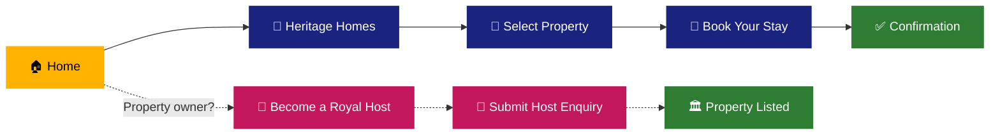

<table width="100%">
<tr>
<td width="15%" align="center">

</td>
<td width="70%" align="center">

</td>
<td width="15%" align="center">

</td>
</tr>
</table>

<div align="center">


<br/>

<a href="https://shahrishabh1513-jsk.github.io/RT-RoyalBNB/"></a>
<a href="https://shahrishabh1513-jsk.github.io/RT-RoyalBNB/listing.html"></a>
<a href="https://github.com/shahrishabh1513-jsk/RT-RoyalBNB"></a>
<a href="https://github.com/shahrishabh1513-jsk/RT-RoyalBNB/stargazers"></a>

<br/><br/>


<br/><br/>


</div>

<br/>

<div align="center">

[](#-live-preview)
[](#-about-the-project)
[](#-key-features)
[](#-site-map)
[](#-user-workflow)
[](#️-tech-stack)
[](#-folder-structure)
[](#-getting-started)
[](#-connect)

</div>

<div align="center"></div>

## 🔍 Live Preview

<div align="center">

<table width="90%">
<tr>
<td>🔴 🟡 🟢 &nbsp;&nbsp; <code>shahrishabh1513-jsk.github.io/RT-RoyalBNB</code></td>
</tr>
<tr>
<td align="center">
<a href="https://shahrishabh1513-jsk.github.io/RT-RoyalBNB/" target="_blank">

</a>
</td>
</tr>
</table>

<br/>

<table width="90%">
<tr>
<td align="center" width="50%">
<b>🏰 Heritage Homes</b><br/><br/>
<a href="https://shahrishabh1513-jsk.github.io/RT-RoyalBNB/listing.html" target="_blank">

</a>
</td>
<td align="center" width="50%">
<b>⭐ Guest Reviews</b><br/><br/>
<a href="https://shahrishabh1513-jsk.github.io/RT-RoyalBNB/reviews.html" target="_blank">

</a>
</td>
</tr>
</table>

<br/>

<a href="https://shahrishabh1513-jsk.github.io/RT-RoyalBNB/listing.html" target="_blank"></a>

</div>

> 💡 Screenshots are captured live by a free service — if one shows blank on first load, refresh once and it fills in within a minute.

<div align="center"></div>

## 📖 About The Project

<table>
<tr>
<td width="60%" valign="top">

**RT RoyalBNB** is a premium, fully responsive **heritage hospitality platform** connecting travelers with palace stays, heritage havelis, and luxury retreats across India.

The site presents curated royal properties, exclusive travel packages, guest reviews, and a host-onboarding flow for property owners — wrapped in an elegant "royal heritage" design language.

It was built to practice **premium booking-platform design**: hero storytelling, curated property showcases, trust-building sections, and two user flows — **guests booking stays** and **hosts listing properties**.

</td>
<td width="40%" valign="top">

| At a glance | |
|---|---|
| 🏰 **Type** | Heritage booking website |
| 🎯 **Focus** | Premium hospitality UX/UI |
| 👑 **Trust** | 4.8/5 · 6K+ guests · Since 2024 |
| 🤝 **Flows** | Guest booking + Host onboarding |

</td>
</tr>
</table>

<div align="center"></div>

## ✨ Key Features

<table>
<tr>
<td width="50%" valign="top" align="center">


<div align="left">

- ✦ **Most Picked Royal Retreats** showcase
- ✧ **Exclusive Royal Packages** across India
- 🏨 Full **Heritage Homes** listing page
- ⭐ Guest **Reviews** page with ratings

</div>

</td>
<td width="50%" valign="top" align="center">


<div align="left">

- 🏛️ **"Become a Royal Host"** partner program
- 🎁 **Zero commission** for 6 months
- 📸 **Free professional photography** offer
- 🛎️ **24/7 host support**

</div>

</td>
</tr>
<tr>
<td width="50%" valign="top" align="center">


<div align="left">

- ℹ️ **About** section with brand story & stats
- 📊 Trust badges: 50+ properties, 15+ destinations
- ✉️ **Contact Us** page with location & phone
- 💒 Wedding & fine-dining experience highlights

</div>

</td>
<td width="50%" valign="top" align="center">


<div align="left">

- 📱 Fully **responsive** across all devices
- 👑 Elegant "royal heritage" visual identity
- 🖼️ Rich, imagery-driven property showcases
- 🔘 Dual CTAs: **Book Your Stay** & **Plan Your Wedding**

</div>

</td>
</tr>
</table>

<div align="center"></div>

## 🗺️ Site Map

<div align="center">

| Page | What's on it | Open |
|:---:|---|:---:|
| 🏠 **Home** | Hero, most-picked retreats, exclusive packages, about & host CTA | [](https://shahrishabh1513-jsk.github.io/RT-RoyalBNB/) |
| 🏰 **Heritage Homes** | Full property listing / booking catalog | [](https://shahrishabh1513-jsk.github.io/RT-RoyalBNB/listing.html) |
| ⭐ **Reviews** | Guest reviews & ratings | [](https://shahrishabh1513-jsk.github.io/RT-RoyalBNB/reviews.html) |
| ✉️ **Contact Us** | Location, phone, email & enquiry form | [](https://shahrishabh1513-jsk.github.io/RT-RoyalBNB/contact.html) |

</div>

<div align="center"></div>

## 🧭 User Workflow



<div align="center"></div>

## 🛠️ Tech Stack

<div align="center">

| Category | Technology | Purpose |
|:---:|:---:|:---|
| **Markup** |  | Semantic page structure |
| **Styling** |  | Responsive layouts & royal-themed styling |
| **Interactivity** |  | Navigation, carousels & interactions |
| **Version Control** |   | Source control |
| **Deployment** |  | Live hosting |

</div>

<div align="center"></div>

## 📂 Folder Structure

<details>
<summary><b>Click to expand the folder structure 📁</b></summary>

```bash
RT-RoyalBNB/
│
├── image/
│   ├── logo/
│   │   ├── RT_LOGO_BG1.png       # Header logo
│   │   └── RT_LOGO_BG2.png         # Footer logo
│   ├── RT_ABOUT.png                  # About section image
│   └── properties/                      # Heritage property images
│
├── index.html                              # Home page
├── listing.html                              # Heritage Homes / booking listing
├── reviews.html                                # Reviews page
├── contact.html                                  # Contact Us page
│
├── css/
│   └── style.css                                    # All styles
│
├── js/
│   └── main.js                                          # Navigation & interactions
│
└── README.md                                                # Project documentation
```

</details>

<div align="center"></div>

## 🚀 Getting Started

<table>
<tr>
<td width="50%" valign="top">

**Option 1 — Use the live site**

No setup needed 👉 **[Open RT RoyalBNB](https://shahrishabh1513-jsk.github.io/RT-RoyalBNB/)**

</td>
<td width="50%" valign="top">

**Option 2 — Run it locally**

```bash
git clone https://github.com/shahrishabh1513-jsk/RT-RoyalBNB.git
cd RT-RoyalBNB
# open index.html in your browser
# (or use Live Server in VS Code)
```

</td>
</tr>
</table>

✅ No build tools, dependencies, or installations required — it's a pure **HTML/CSS/JS** project.

<div align="center"></div>

## 🧭 Roadmap

<table>
<tr>
<td width="50%" valign="top">

**✅ Done**
- [x] Home, Heritage Homes, Reviews & Contact pages
- [x] Guest booking CTAs & host onboarding CTA
- [x] Trust signals (ratings, guest count, property count)

</td>
<td width="50%" valign="top">

**🚧 Up next**
- [ ] 🔧 Backend integration for real booking & payments
- [ ] 🔍 Property search & filtering (location, price, type)
- [ ] 🔐 Guest & host account system
- [ ] 🌙 Dark mode

</td>
</tr>
</table>

<div align="center"></div>

## 🤝 Connect

<div align="center">

**Rishabh Alpeshabhai Shah**

<a href="https://rishabh-shah-portfolio.netlify.app/"></a>
<a href="https://www.linkedin.com/in/rishabh-alpeshabhai-shah-91b9072a6/"></a>
<a href="mailto:shahrishu1515@gmail.com"></a>
<a href="https://github.com/shahrishabh1513-jsk"></a>

<br/><br/>

### ⭐ If you like this project, give it a star — it helps a lot!


<br/>

**Made with 👑 & ❤️ by Rishabh Shah**


</div>
